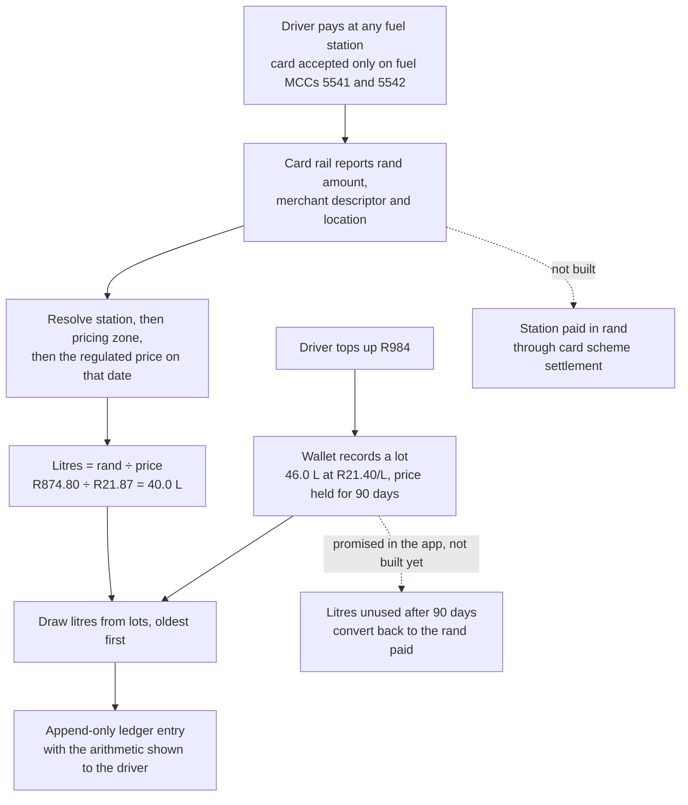

# Barrel

Barrel is a prepaid fuel wallet for South African motorists that counts in litres, not rand. You buy petrol at today's pump price, the litres keep that price for 90 days, and you spend them at any fuel station with a card that only works at fuel merchants. When the pump price goes up, the litres you already hold have already been paid for at the old price.

This repository holds a working prototype: an Expo / React Native app over mock data, plus the product, regulatory and backend design behind it. There is no backend, no money moves, and there is no bank partner, legal opinion or station agreement. The app is a way to test the flows and to think the product through properly before any of that exists.

**What's worth reading**

- **The litre is derived, not measured.** A card transaction carries a rand amount, not litres. Barrel converts it using the regulated petrol price for the station's pricing zone on the transaction date. The conversion is exact only because the product is petrol-only, and that is why diesel is out of scope.
- **Litres are held as dated lots**, each with the price paid and a 90-day expiry, not as one balance. That single structure gives expiry, first-in-first-out spending and an honest savings figure.
- **A pure, tested model.** `src/lib` is twelve files of React-free TypeScript that take time as an argument and never read a clock. 295 Jest tests cover it.
- **The design's numbers were wrong, and the code proves it.** The original design overstated savings by roughly 18 times. The demo data was rebuilt so that every figure on screen is computed, and tests pin the arithmetic.
- **A security finding with a designed fix.** The session was stored in plaintext `AsyncStorage`. The plan moves it to the iOS Keychain / Android Keystore.
- **A backend designed not to double-spend.** It uses integer millilitres and cents, an append-only ledger, idempotency keys, row locks, an invariant re-check before commit, and Postgres row-level security. It is designed but not built.

## The problem

South African petrol prices are regulated and change once a month, on the first Wednesday. A driver can often see a rise coming and has no way to act on it beyond filling the tank they already have. Barrel lets someone buy fuel ahead of a rise and use it over the next few weeks, at any station, without a partner network.

The product sells price certainty, not a return. Because of the 90-day window, the advantage anyone can hold is small: the docs put it at about R20 on a 42 L balance. The docs say plainly that no copy may imply savings compound.

## How Barrel works



The solid path is implemented in the prototype's model and store. The dotted paths are designed but not built: payments, settlement and the expiry conversion all wait on the legal opinion and the backend.

## Product and regulatory design

**Why petrol only.** Petrol 95 has one government-set retail price per pricing zone per month, so Barrel knows what a litre costs at every station in the country without signing a single one. Diesel's retail price is set by each station, so the same card would expose Barrel to whatever a premium highway forecourt chose to charge. The spec treats diesel as excluded, not deferred. It also notes that adding diesel would bring the most price-exposed grade to the most fuel-intensive drivers, so a price-risk control has to exist before it ships.

**A voucher, and the question it raises.** The litre balance is designed as a prepaid voucher redeemable only for fuel, and the card is restricted to merchant category codes 5541 and 5542. That restriction is the basis for arguing that Barrel is not a regulated financial product under FSCA/FAIS oversight. The design does not treat this as settled. It frames two separate questions for counsel:

1. Is a prepaid, litre-denominated instrument redeemable only for fuel a voucher rather than a regulated financial product?
2. Does converting a litre balance into rand at a floating price, and settling that rand to a third-party merchant, change the answer?

A yes to only the first would be false comfort, because the open-loop card is where the exposure actually sits.

**Consumer protection built into the rules.**

- Expiry is not forfeiture (Consumer Protection Act s63). The 90 days is how long a litre holds its price, and unused litres are meant to convert back to the rand paid.
- No cash-out above the purchase price.
- The subscription says "cancel any time, your litres stay yours" (CPA s14). A lapsed subscription never blocks the card or an existing balance, because withholding litres already bought would be a cash-out restriction by another name.
- There are two caps that limit opposite flows. A monthly top-up cap of 500 L per vehicle limits what can be bought in. A weekly redemption cap of 110 L limits how fast it can be spent, as a defence against bulk resale. The weekly window rolls over the trailing seven days rather than resetting on a weekday, because a calendar reset would allow double the limit within a few hours across the boundary.
- Every fill shows its own arithmetic, plus the zone and effective date used. Those are the two inputs that can be wrong. A "this doesn't match my receipt" button flags the fill, because a zone misassignment is silent from the inside and only surfaces through a driver holding a receipt.

**Privacy (POPIA).** The backend design puts data in Frankfurt, because neither Supabase nor Neon offers a South African region, and it treats that as a cross-border transfer to disclose. It resolves the conflict between the right to erasure and an append-only financial ledger by encrypting personal details with a per-user key and destroying the key on request (crypto-shredding). FICA/KYC onboarding is out of scope until the legal opinion.

**The economics.** Phase 1 revenue is a R59/month subscription, float, and issuer interchange through a sponsor bank. The spec sizes interchange honestly. SA fuel retailers pay about 1.75% in total merchant service fees, and that is the whole pie shared by scheme, acquirer and issuer. On a 40 L fill (R874.80) the entire fee is R15.31, roughly what a R0.40/L station rebate would have earned on its own, and Barrel gets only a fraction of it. The conclusion recorded in the spec is that the subscription carries phase 1.

**Why v1 is the control group.** The longer-term strategy is demand-side aggregation: build a habitual user base, then sell stations a per-litre rebate for steering volume to them. What makes that saleable is demonstrated elasticity, meaning proof that a nudge of known size moves a known volume. Elasticity can only be measured against a baseline of where drivers fill when nobody is nudging them. So the data model records, from the first fill, the normalised station, the raw merchant descriptor, the zone, the price, the timestamp and the driver's prior fills, before any steering exists. Launching steering and measurement together would leave no counterfactual. Denominating in litres also makes users price-blind, since 40 litres costs 40 litres anywhere, so a small nudge later decides station choice.

The wider commercial structure was worked through in a separate business overview that is not part of this repository. That covers issuing through a sponsor bank under a programme-manager model, hedging the litre-price exposure with an OTC swap, and mapping the requirements across SARB, PASA, FICA, FAIS and POPIA.

## App architecture

```
src/lib/         the model: pure TypeScript, no React, no clock (12 files)
src/data/        types, the zone price table, stations, the demo seed
src/store/       zustand stores (wallet, session) wrapping src/lib, persisted locally
src/theme/       design tokens and provider; the only file allowed to contain a hex colour
src/components/  18 shared components, including hand-built SVG line and bar charts
app/             12 screens and 2 layouts, file-based routing with expo-router
web/             a separate Next.js waitlist site with its own lockfile
docs/            specs, plans, decisions, known gaps, handover
```

Logic lives in `src/lib` and the screens follow it. The split matters for the backend. Only two files, `lots.ts` and `caps.ts`, change what a user owns. The other ten only compute views. So the backend design moves those two to the server and keeps every derivation running on the device.

## Engineering notes

**Lots, not a balance.** A `Lot` is one purchase: litres remaining, price per litre, purchase date and an expiry 90 days later. A balance is the sum of unexpired lots. Spending draws the oldest lots first (`consumeFifoWithCost`), and the same function reports what the consumed litres cost. That cost is the sole input to the savings figure, so there is exactly one definition of it. An early build had the loop duplicated between the seed builder and the store's card-fill action, where two copies drifting apart would make the savings number silently lie. Merging them also exposed a bug in the demo data: the seed held litres for 118 days, which the product's own 90-day rule forbids.

**Rand in, litres out.** The card rail gives an issuer the merchant descriptor, MCC, location, rand amount and timestamp, and never litres. `normaliseDescriptor` matches dirty descriptors such as `ENGEN WILLIAM NICOL 4412` against known stations. When there is no match, the fill is still priced from the zone of the transaction's location, never from a national average. A national fallback would put a systematic, invisible error into every unattributed fill near a zone boundary. If no zone can be established, the design queues the fill for manual pricing rather than guessing.

**Time is an argument.** Nothing in `src/lib` or `src/data` calls `now()`. Every date-sensitive function takes an explicit `at: Date`, which is what makes the model testable. The store and the screens read the clock once per action or render (`const at = now()`), so a single top-up cannot straddle a date boundary and disagree with itself about the price, the cap window and a lot's expiry. The demo clock is pinned to 30 September 2026 because the seed is dated absolutely. Unpinning it is recorded as a product decision, not a one-line change.

**Every number is derived.** The source design canvas contained arithmetic that did not hold up:

- Savings were shown as R1,284 alongside "58.7 L below pump", but 58.7 × R21.87 = R1,283.77. The canvas had labelled the value of the litres as the saving on them, which overstated savings by roughly 18 times against the ledger.
- An alert claimed "2.4 L saved", which is about five times what the two prices on the same screen imply.
- The ledger's running balance did not chain.

The seed was rebuilt so the ledger chains to the 42.6 L balance that every screen shows. Every historical fill draws only unexpired lots, and a test asserts that the six monthly savings bars add up to the headline figure. When the honest savings number turned out small and flat, the decision recorded was to keep it and label it as realised, not to find a bigger number.

**Persisting a model full of dates.** JSON turns every `Date` into a string, after which every comparison is silently wrong. The persistence layer tags dates explicitly as `{"__d": "..."}` on the way out and rebuilds them on the way in. Reviving any string that looks like an ISO date was rejected, because merchant descriptors and ledger detail are free text and one would eventually match. State written by an unknown store version is discarded rather than half-migrated.

**`AsyncStorage` is not encrypted.** During a routine check, the signed-in session (phone number and sign-in time) was read straight out of storage in cleartext. A phone number is personal information under POPIA, and a session is an access credential. `AsyncStorage` had been chosen because it runs in Expo Go without a native build, which was a sound tooling call at the time but was never revisited. The fix is designed in the foundations plan (`docs/superpowers/plans/2026-09-14-barrel-foundations.md`, task 3):

- A small zustand storage adapter over `expo-secure-store` puts the session in the iOS Keychain / Android Keystore.
- The adapter reuses the existing date handling rather than writing a second one.
- It treats any storage error as "signed out" rather than a crash.
- On web it falls back to `localStorage`, explicitly labelled as a development surface only.

The wallet data stays in `AsyncStorage` for now: it holds no credential and is due to move to the server. **The fix is planned, not shipped.** The session is still in `AsyncStorage` today.

**Contrast is a test, not a review step.** The app is meant to be used at a pump, often outdoors in glare, so light mode holds every text token to WCAG AAA (7:1) rather than AA. `tokens.test.ts` computes relative luminance for every text token against its theme's background and fails the suite if one slips. It also checks borders against the 3:1 non-text minimum. Brand colours that cannot meet text contrast on white, such as amber and lime, are split into a fill token and a separate text token. A shadow is invisible on a black background, so elevation exists in light mode only and is applied through one hook rather than by screens checking the theme.

**Sign-in is a stub in exactly one place.** Phone validation for South African numbers is real, and so are the session store and the route guard (`Stack.Protected` in expo-router). Only the code check is fake. The session lives in its own store so that resetting the demo wallet does not sign the user out.

## Backend design (specified, not built)

`docs/superpowers/specs/2026-09-13-barrel-backend-design.md` describes the server behind the app, delivered phase by phase. Each phase leaves the app working, and none requires the next one to start. The scope is real accounts and a real wallet on a server, with no money moving.

- **Integers from the first migration.** Litres are stored as millilitres and money as cents, both `bigint`, in the database and in the shared model. Using `numeric` in Postgres with floats in TypeScript would only move the rounding error to the boundary between them.
- **The database enforces its own rules.** Row-level security means a user can only read their own lots and ledger. Clients may read the ledger but never write to it. `update` and `delete` are revoked on the ledger, so a correction is a new row. Each ledger row has an `occurred_at` and a `recorded_at`, kept separate, because they diverge for queued fills and late settlements.
- **Three mechanisms make a mutation safe, and the spec explains why any two of them leave a hole:**
  - An idempotency key stored with a hash of the request. The same key and body replays the stored result, and the same key with a different body is rejected.
  - A transaction holding a row lock on the user.
  - An invariant re-check before commit, so that the ledger's balance must equal the sum of the lots.

  The worked example is a retried 40 L fill against 42.6 L. Without these mechanisms, the screen shows 2.6 L while 80 L is drawn. With them, there is one ledger row.
- **The same TypeScript runs on the server.** `src/lib` moves to a `packages/model` workspace that an Edge Function imports unchanged. FIFO is not rewritten in SQL, which would be atomic for free, because two implementations in two languages would bring back the drift hazard described above.
- **Sign-in uses WhatsApp OTP first and SMS as fallback**, chosen for cost and deliverability in South Africa. The spec requires SMS-pumping controls before launch: per-number, per-IP and per-device rate limits, a daily spend ceiling, and monitoring of the deliver-to-verify ratio.
- **Tests are ordered by damage.** RLS policy tests come first and run as a real second user against a real Postgres. Then come integration tests against a local Supabase rather than mocks, and concurrency tests that must fail if a safety mechanism is removed.

## The website

`web/` is a separate pre-launch waitlist site: Next.js 16 as a static export, a POPIA privacy notice and terms of use, with sign-ups handled by Buttondown using double opt-in and no open or click tracking. It has no test runner by design. Its gate is `web/scripts/check.mjs`, which runs against the source and the built output. Among other things, it enforces:

- the design rules: a closed palette, no fill colour used as text, no gradients, no centred layout and a radius ceiling;
- a content rule: product mechanics such as the 90-day window and the caps appear only in `/terms`;
- source citations on every price figure;
- no third-party requests beyond Buttondown;
- **no import that resolves outside `web/`.**

That last rule exists because the app's price table (`src/data/prices.ts`) is invented demo data, a fictional 2026 supply shock. The site's chart uses real published Department of Mineral and Petroleum Resources figures, cross-checked against the AA's series, and the gate makes it impossible for the invented numbers to reach a public page.

## Stack

- **App:** Expo SDK 57, React Native 0.86, React 19.2, TypeScript 6 (strict), expo-router, zustand 5 with the persist middleware over AsyncStorage, react-native-svg, expo-haptics, Figtree and JetBrains Mono. There is no UI component library, no chart library and no animation library beyond React Native's `Animated`.
- **Tests:** Jest 30, jest-expo, React Native Testing Library.
- **Website:** Next.js 16 (static export), React 19.2, ESLint 9, Buttondown for the waitlist.
- **Designed backend:** Supabase Postgres with RLS, Edge Functions, `expo-secure-store`, EAS Build.

## Running it locally

You need Node 20.19 or later. The app runs in Expo Go, so no native build is needed.

```bash
npm install
npx expo start          # then press w for web, a for Android, i for iOS
```

`npm run web`, `npm run android` and `npm run ios` start a specific target directly.

Notes for a first run:

- **Sign-in is a stub.** Enter any valid South African mobile number, for example `082 123 4567`, and any six digits.
- **The app's "today" is pinned to 30 September 2026**, and the wallet opens on seeded demo data.
- Both stores persist between launches. **Settings → Reset demo data** restores the seed without signing you out.
- These seeded figures should read the same on every screen: a balance of **42.6 L**; today's price **R21.87/L** (inland 95, rising on 7 October); **12.0 L** expiring in 6 days; and **R76.19** in realised savings.

The website is a separate project with its own dependencies:

```bash
cd web
npm ci
npm run dev             # http://localhost:3000
npm run verify          # next build, then the design and content checks
```

## Tests and checks

```bash
npm test                # 295 Jest tests in 23 suites
npx tsc --noEmit        # strict type-check of the app (web/ is excluded and checks itself)
cd web && npm run lint && npm run verify
```

The app's tests cover `src/lib`, `src/data`, both stores (including a real write through the persist middleware), isolated components, and the theme's contrast ratios. No test renders a full screen. A chart bug that squeezed both lines into the middle third of the panel passed every test and was caught only by opening the app. Visual changes are therefore checked by running it, and `.claude/skills/run-barrel/SKILL.md` documents how to do that on web, the Android emulator and the iOS simulator.

GitHub Actions runs on every push and pull request: the app's type-check and Jest suite, and the website's lint and `npm run verify`.

## Status and known gaps

This is a prototype over mock data. The price table is invented and the clock is pinned. Nothing here has a backend, payments, card issuing, KYC, a bank, station agreements or a legal opinion behind it.

The gaps the docs rank highest:

- **The app makes a promise it does not keep yet.** Three screens say unused litres convert back to the rand paid. The `expiry` ledger kind is declared but never written, and an expired lot just stops counting. It is the first item on the to-do list.
- Top up has no confirmation step and no receipt.
- A declined card fill records its reason, but no screen shows it.
- Some controls are inert, including the Apple Wallet and Google Pay buttons.
- New users would land on undesigned empty states.
- The session is still in plaintext `AsyncStorage` until the foundations plan's task 3 lands.

The full audit is in `docs/GAPS.md`, and the ordered next steps are in `docs/TODO.md`.

## How it was built

The specs and plans under `docs/superpowers/` were written to drive AI coding agents (Claude Code). `AGENTS.md` is the rules file every agent session reads: the ten rules that must not be broken, and the traps that came up repeatedly during the build. `docs/DECISIONS.md` records each design and engineering ruling with its reasoning and its cost if wrong. When the build plan and the spec disagreed, the spec won. That happened seven times, mostly over figures copied from the design canvas.

| Document | What it covers |
|---|---|
| `docs/superpowers/specs/2026-09-06-barrel-fuel-wallet-design.md` | The product spec: data model, guardrails, card-fill derivation, phase 2 instrumentation, open legal risks |
| `docs/superpowers/specs/2026-09-09-barrel-pump-redesign-design.md` | The current design system and four added features |
| `docs/superpowers/specs/2026-09-13-barrel-backend-design.md` | The server design and its phased rollout |
| `docs/superpowers/plans/2026-09-14-barrel-foundations.md` | CI, the shared model package, secure session storage, EAS builds |
| `docs/DECISIONS.md` | Every ruling, with cost if wrong |
| `docs/GAPS.md` | What is missing and why it matters |
| `docs/UI.md` | Every screen, every number and where it comes from |

## License

No license file has been added, so default copyright applies.
